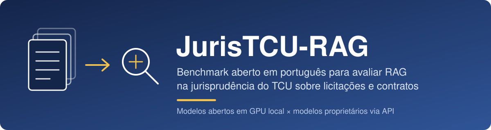
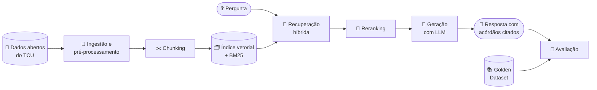
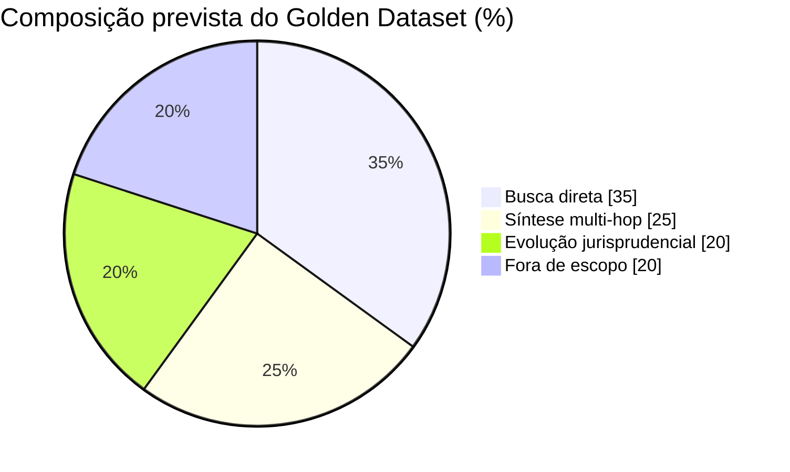
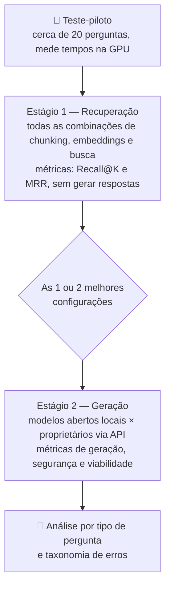
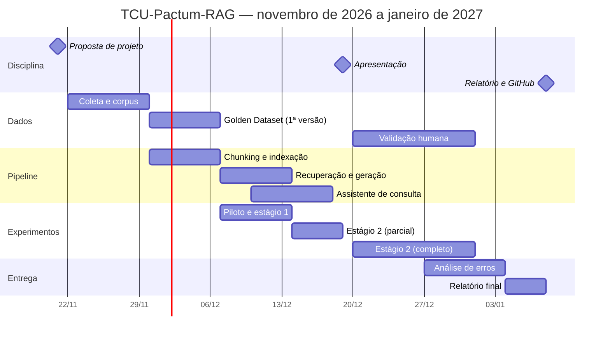

  

  
  
  
  

  
  
  
  
  

  <a href="#-o-problema">Problema</a> •
  <a href="#-o-que-vamos-entregar">Entregas</a> •
  <a href="#-arquitetura">Arquitetura</a> •
  <a href="#-etapas-do-projeto">Etapas</a> •
  <a href="#-modelos">Modelos</a> •
  <a href="#-avaliação">Avaliação</a> •
  <a href="#-cronograma">Cronograma</a> •
  <a href="#-equipe">Equipe</a>

---

> [!NOTE]
> Projeto final da disciplina de **IA Generativa / LLMs** (Prof. Marcelo Pita). O repositório está na fase de proposta: o código ainda não foi escrito, e este README descreve o que será construído.

## 🎯 O problema

Os acórdãos do **Tribunal de Contas da União (TCU)** orientam gestores, pregoeiros, agentes de contratação e auditores de todo o país. Consultá-los é trabalhoso: as decisões são longas, divididas em Relatório, Voto e Acórdão, e o entendimento do Tribunal muda com o tempo.

Assistentes com LLMs aceleram essa consulta, mas erram de formas graves no contexto jurídico:

| | Tipo de erro | Exemplo |
|---|---|---|
| 🔢 | Citação inventada | Número de acórdão que não existe |
| ⚖️ | Voto vencido como decisão | Atribuir ao acórdão o conteúdo de um voto que perdeu |
| 🕰️ | Entendimento superado | Apresentar como vigente uma posição já revista |

A técnica de **RAG** (Geração Aumentada por Recuperação) reduz esses erros ao ancorar a resposta em documentos recuperados. Falta evidência, em português, de qual configuração funciona melhor para a jurisprudência de controle externo.

> [!IMPORTANT]
> **Pergunta de pesquisa:** em que medida arquiteturas de RAG, especialmente com modelos abertos executados localmente, conseguem recuperar e sintetizar a jurisprudência do TCU com fidelidade normativa, baixo índice de alucinação e custo viável para órgãos públicos?

Há ainda um dilema próprio da Administração Pública: modelos proprietários via API tendem a responder melhor, enquanto modelos abertos em máquina local favorecem soberania de dados, conformidade com a LGPD e previsibilidade de custos.

## 📦 O que vamos entregar

| | Entrega | Descrição |
|---|---|---|
| 💬 | **Assistente de consulta** | Pergunta em linguagem natural, resposta com os acórdãos citados |
| 📚 | **Benchmark TCU-Pactum-RAG** | No mínimo 100 pares pergunta–resposta validados (meta de até 250), publicados no Hugging Face |
| 🔧 | **Pipeline reprodutível** | Ingestão, indexação, recuperação, geração e avaliação em código aberto |
| 📊 | **Comparativo empírico** | Qualidade, latência e custo: APIs × modelos abertos em uma RTX 4090 |
| 🧭 | **Taxonomia de alucinações jurídicas** | Catálogo dos tipos de erro observados |
| 📘 | **Guia prático** | Recomendações para adoção segura de RAG na Administração Pública |

## 🏗 Arquitetura

O pipeline é modular: cada etapa pode ser trocada por configuração, o que permite comparar variações sobre o mesmo conjunto de perguntas.

## 🗺 Etapas do projeto

### 1️⃣ Coleta e corpus

Tudo parte de dados públicos, em CSV, do Portal de Dados Abertos do TCU (seção Jurisprudência).

| Fonte | Conteúdo |
|---|---|
| Acórdãos (inteiro teor) | Relatório, Voto e Acórdão, com número/ano, colegiado, relator, data da sessão, tipo de processo e assunto |
| Jurisprudência Selecionada | Enunciados que resumem entendimentos, ligados ao acórdão de origem e indexados por área, tema e subtema |
| Súmulas e Respostas a Consultas | Entendimentos consolidados |
| Normas de referência | Leis nº 14.133/2021 e nº 8.666/1993 |

**Recorte:** licitações e contratos, de 2021 a 2026, com prioridade para decisões de mérito do Plenário e das Câmaras. O período cobre a transição da Lei 8.666 para a Lei 14.133; cada acórdão será marcado com o regime legal que aplica.

| Componente | Volume estimado |
|---|---|
| Acórdãos do recorte | 3.000 a 5.000 documentos |
| Enunciados da Jurisprudência Selecionada | 1.000 a 2.000 |
| Texto total | ≈ 40 a 80 milhões de tokens |
| Chunks indexados | ≈ 100 mil a 300 mil |

Os volumes são estimativas e serão confirmados na coleta.

### 2️⃣ Golden Dataset

Conjunto de perguntas com resposta de referência e acórdãos de suporte. Os enunciados da Jurisprudência Selecionada servem de ponto de partida, porque já trazem o acórdão de origem como gabarito de recuperação. As perguntas são geradas com apoio de LLM e revisadas por pessoas.

| | Tipo | O que testa |
|---|---|---|
| 🎯 | Busca direta | Enunciado presente em um único acórdão |
| 🔗 | Síntese multi-hop | Cruzamento de dois ou mais acórdãos (regra geral + exceção) |
| 🕰️ | Evolução jurisprudencial | Mudança de entendimento, inclusive na transição da 8.666 para a 14.133 |
| 🚫 | Fora de escopo | Pergunta sem respaldo na base; mede se o modelo se abstém ou inventa |

Uma amostra é revisada por 2 a 3 especialistas, com a concordância medida pelo kappa de Cohen ou de Fleiss.

### 3️⃣ Pipeline RAG

<b>✂️ Chunking</b> — três estratégias comparadas

- Tamanho fixo com sobreposição
- Estrutural, por seção e parágrafo numerado
- Semântico

Todo chunk carrega número do acórdão, colegiado, data e seção de origem.

<b>🗂 Indexação</b>

- Embeddings densos multilíngues: BGE-M3 e multilingual-E5-large
- Base vetorial: Qdrant ou FAISS
- Índice lexical BM25

<b>🔎 Recuperação</b> — quatro variantes

1. Vetorial pura
2. Híbrida BM25 + densa, com fusão por Reciprocal Rank Fusion
3. Híbrida com reranking por cross-encoder (bge-reranker-v2-m3)
4. Filtros por metadados (data, colegiado), para perguntas de evolução jurisprudencial

<b>🤖 Geração</b>

O prompt exige três coisas do modelo:

- citar o número do acórdão que sustenta cada afirmação;
- usar apenas o contexto recuperado;
- declarar que não há respaldo quando a base não responde à pergunta.

### 4️⃣ Experimentos em dois estágios

Combinar todas as opções de chunking, recuperação e modelos geraria dezenas de configurações. Os experimentos são divididos para manter a matriz executável:

### 5️⃣ Análise e entrega

- Cálculo das métricas e análise por tipo de pergunta
- Classificação dos erros na taxonomia de alucinações jurídicas
- Relatório final (ensaio ou artigo) com o guia de recomendações
- Publicação do código neste repositório e do dataset no Hugging Face

## 🤖 Modelos

| Categoria | Candidatos | Onde roda |
|---|---|---|
| 🏠 LLMs abertos | Llama, Qwen e Gemma, de 7B a 14B (4 ou 8 bits), e um modelo de 27B a 32B em 4 bits como teto local | GPU local, via Ollama ou vLLM |
| ☁️ LLMs proprietários | Um ou dois modelos de ponta (GPT, Claude ou Gemini) e o Sabiá | API |
| 🧬 Embeddings | BGE-M3, multilingual-E5-large | GPU local |
| 🥇 Reranker | bge-reranker-v2-m3 | GPU local |
| 👩‍⚖️ Juiz (LLM-as-a-Judge) | Modelo de maior porte, diferente dos avaliados, calibrado com rótulos humanos | API |

As versões exatas serão fixadas no início dos experimentos. Orquestração prevista com LangChain ou LlamaIndex, e RAGAS como apoio às métricas.

## 🖥 Infraestrutura

Toda a parte local roda em uma única estação com **NVIDIA RTX 4090 de 24 GB de VRAM**: embeddings, reranking e inferência dos LLMs abertos. É um equipamento de consumo, ao alcance do orçamento de um órgão público, e por isso define o cenário de soberania de dados do estudo.

- **Capacidade:** modelos de 7B a 14B cabem com folga; modelos de 27B a 32B cabem em 4 bits.
- **Comparabilidade:** a janela de contexto é configurada de forma explícita e igual para todos os modelos locais.
- **Execução:** rodadas em lote, por script, com salvamento de resultados parciais.
- **Contingência:** GPU equivalente alugada em nuvem, se a estação ficar indisponível.

## 📏 Avaliação

| | Dimensão | Métricas |
|---|---|---|
| 🔎 | Recuperação | Recall@K e MRR |
| ✍️ | Geração | Fidelidade ao contexto, correção factual, exatidão da citação |
| 🛡 | Segurança | Taxa de alucinação e taxa de abstenção correta |
| 💰 | Viabilidade | Latência por consulta e custo por mil consultas (API × aquisição e energia da GPU) |
| 🤝 | Confiabilidade | Concordância entre o LLM-juiz e avaliadores humanos |

## 📅 Cronograma

As datas em destaque são os prazos da disciplina. A distribuição das fases entre elas é um planejamento do grupo e pode mudar.

| Etapa | Entrega | Peso | Prazo |
|---|---|---|---|
| 1 | Definição das equipes | 0 | 15/11/2026 |
| 2 | Proposta de projeto | 1,0 | 21/11/2026 |
| 3 | Apresentação do projeto/sistema | 3,0 | 19/12/2026 |
| 4 | Relatório (ensaio ou artigo) | 4,0 | 08/01/2027 |
| 5 | Código e arquivos em GitHub público | 2,0 | 08/01/2027 |

## ✅ Andamento

- [x] Equipe definida
- [x] Proposta de projeto redigida
- [ ] Coleta e corpus
- [ ] Golden Dataset
- [ ] Pipeline RAG
- [ ] Assistente de consulta
- [ ] Experimentos (estágios 1 e 2)
- [ ] Apresentação
- [ ] Relatório final e publicação do dataset

## 📁 Documentos

| Arquivo | Conteúdo |
|---|---|
| [docs/Proposta_Projeto_RAG_TCU_v2.pdf](docs/Proposta_Projeto_RAG_TCU_v2.pdf) | Proposta de projeto (versão atual) |
| [docs/PROJETO.md](docs/PROJETO.md) | Guia de trabalho: tarefas por fase, calendário, riscos e decisões em aberto |
| [docs/Proposta_Projeto_RAG_TCU.pdf](docs/Proposta_Projeto_RAG_TCU.pdf) | Proposta original, mantida como histórico |

## 👥 Equipe

| Integrante | Papel principal |
|---|---|
| **Alexandre Ferreira Ponte** | Coordenação, desenho do benchmark e curadoria do Golden Dataset |
| **Elisangela Osório** | Coleta, limpeza e chunking do corpus; avaliação e análise de erros |
| **Renê Estevam Deckers** | Pipeline de recuperação, geração com LLMs e execução dos experimentos na GPU |

## ⚖️ Ética e dados

O corpus é composto apenas por decisões públicas, disponibilizadas pelo próprio TCU em formato aberto. Acórdãos sigilosos não constam da base. As respostas do assistente são apoio à pesquisa de jurisprudência e não substituem a leitura do acórdão nem a análise jurídica.

## 📄 Licença

Código sob licença [MIT](LICENSE).
